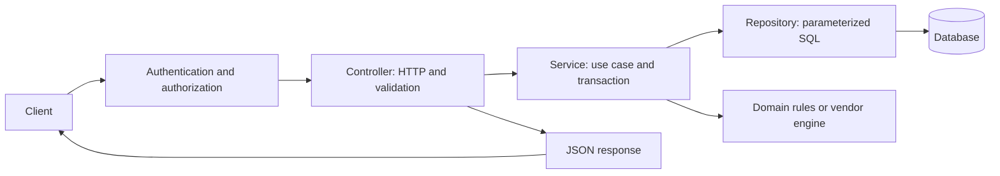

# Java development practices and the software development lifecycle

This guide provides a practical baseline for developing, reviewing, releasing and operating Java APIs. It explains the reasons behind the conventions and applies them to Regulus. Practices should match the system's risk and complexity; no checklist covers every design decision.

**Scope:** documentation and recommended standards. Examples marked **proposed** are not enabled in the build or pipeline by this guide. The current project uses Java 8, Gradle 8.14.2, Spring Boot 2.7.18, Spring MVC/JDBC/Security and an executable JAR with embedded Tomcat.

For runnable commands and environment setup, see the [developer README](../README.DEVELOPMENT.md), [runtime and CI/CD guide](RUNTIME-AND-CICD.md), [Windows deployment guide](ASSESSMENT-AND-DEPLOYMENT.md) and [OpenAPI contract](openapi.yaml).

## 1. SDLC: turn a requirement into an operated feature

The software development lifecycle (SDLC) includes planning, implementation, verification, release and maintenance. It is iterative: production feedback often becomes the next requirement.

| Stage | Work to perform | Evidence to retain |
| --- | --- | --- |
| Requirements | Identify users, expected outcomes, edge cases, security needs and acceptance criteria | Issue/story with observable examples |
| Design | Define API/data changes, layer responsibilities, failure behavior, compatibility and deployment approach | OpenAPI change, schema proposal and a short design note for significant decisions |
| Implementation | Make a focused change, add appropriate tests and update documentation | Reviewable commits and a pull request |
| Verification | Run automated checks and assess real database/runtime behavior | CI results, test reports, coverage and acceptance results |
| Release preparation | Choose a version, identify the commit, build/package and plan rollback | Immutable artifact, checksum, release notes and configuration requirements |
| Deployment | Install the approved artifact, apply planned migrations and verify the instance | Deployment record, artifact identity and health results |
| Operations | Observe errors, latency, availability and business correctness; respond to incidents | Dashboards/logs, incident notes and follow-up actions |
| Maintenance/retirement | Update dependencies, remove deprecated interfaces and plan supported-runtime upgrades | Upgrade plan, compatibility tests and consumer communication |

An acceptance criterion should describe behavior: “Updating one account's name leaves its firm/account key and other fields unchanged,” rather than “Add a PATCH method.” Include failure cases such as missing accounts, unauthorized users and database errors.

For financial changes, have the domain owner approve representative inputs and expected balances, settlement behavior and rounding. A successful HTTP response alone is insufficient evidence of accounting correctness.

## 2. Standard project structure and namespaces

Use the build tool's standard source directories so IDEs, CI and new developers agree on what gets compiled and packaged.

```text
regulus-api/
  settings.gradle                 Project identity and build settings
  build.gradle                    Dependencies, compilation, testing and packaging
  gradlew / gradlew.bat            Reproducible build-tool entry points
  gradle/wrapper/                  Wrapper configuration and bootstrap JAR
  src/main/java/com/regulus/api/
    App.java                      Spring Boot entry point
    controller/                   HTTP boundary
    service/                      Application use cases and transaction orchestration
    repository/                   Database access
    model/                        Existing DTOs and domain classes
    config/                       Dependency/security configuration
    exception/                    Application errors
  src/main/resources/             Packaged configuration defaults and resources
  src/test/java/                  Automated tests
  src/test/resources/             Test-only fixtures/configuration, when needed
  docs/                           Design, API and operational documentation
  deployment/                     Deployment scripts and templates
  .github/workflows/              CI/CD definitions
  libs/                           Documented vendor-binary exception
  build/                          Generated output; never hand-edit or commit
```

Use a lowercase reverse-domain package namespace owned by the organization. The current namespace is `com.regulus.api`; agree on ownership before publishing shared libraries. A package declaration must correspond to its directory. Use `AccountService` for classes, `findByFirmId` for methods and `MAX_BATCH_SIZE` for constants; avoid default-package application classes.

Keep the Boot application class above the packages it scans. Do not scatter component-scan overrides merely to compensate for disorganized packages.

Layer-based packages are reasonable for this small application. As independent features grow, consider packages such as `account.controller`, `account.service` and `account.repository`, with explicit interfaces between features. Create separate Gradle modules when they enforce a useful dependency boundary or have a distinct lifecycle, not merely to add folders.

In this repository, `docs/original` and `current_deployment` are historical/reference material, not active source roots. Keep fixtures and documentation free of real customer data or credentials. Archived source should be clearly labeled so developers do not modify an inactive controller by mistake.

## 3. MVC and application layers

Model–View–Controller separates representation and interaction concerns. For a REST API, the view is the serialized HTTP representation, usually JSON, rather than an HTML page. MVC does not mean that every model must be a database entity.



| Component | Responsibility | Avoid |
| --- | --- | --- |
| Controller | Map routes, bind/validate input, choose HTTP status and return response DTOs | SQL, connection management and accounting calculations |
| Service | Execute business use cases, coordinate domain logic and define transaction boundaries | Depending on servlet request/response objects |
| Repository | Read/write data and map database rows | HTTP status decisions and client authentication |
| Domain model | Represent business state and enforce domain invariants | Request-scoped mutable state stored globally |
| Request/response DTO | Define a deliberate public contract | Accidental exposure of every database/vendor field |
| Exception handler | Convert known failures to consistent HTTP errors | Returning SQL text, credentials or stack traces |

Regulus follows controller → service → repository. Its preserved local `AccountAsset` still has persistence helpers, so it is not a perfectly separated domain model. Treat that as a known boundary to improve when that code becomes an active feature. Do not replace the vendor engine with the local model without verified behavioral equivalence.

For new code, prefer request DTOs separate from persistence models when their validation, exposure or lifecycle differs. An illustrative `CreateAccountRequest` might require identity fields, while `PatchAccountRequest` must distinguish omitted values from explicit changes. In the current API, null PATCH fields mean “unchanged,” not “clear this field”; preserve that documented contract unless changing it deliberately.

Constructor injection makes dependencies explicit and simplifies testing. Prefer composition over deep inheritance and cohesive classes over broad “utility” classes. Introduce interfaces where there are alternative implementations or an external boundary; an interface for every class is unnecessary.

## 4. Everyday Java coding practices

Write code that makes invalid states and failure paths understandable to the next maintainer.

- Use descriptive names, small cohesive methods and consistent formatting. Comments should explain constraints or decisions rather than restate obvious code.
- Prefer immutable values and `final` fields where practical. Do not expose mutable internal collections unnecessarily. Define null handling at boundaries instead of allowing distant null-pointer failures.
- Compare object values with `equals`; implement `equals` and `hashCode` together when objects need value equality. Use enums for a known finite vocabulary, without guessing undocumented vendor codes.
- Use generics rather than raw collections. Keep streams readable and avoid side effects hidden in complex pipelines.
- Close resources with try-with-resources when your code owns them. With Spring JDBC, let Spring manage the connection lifecycle; do not manually close a transaction-managed connection.
- Catch exceptions where you can recover or add useful context. Preserve the cause when wrapping. Do not swallow exceptions and return a success response.
- Use logging APIs rather than `System.out` or `printStackTrace`. Log an error once at the boundary that owns it, with a correlation identifier and sanitized context.
- Keep singleton Spring services stateless with respect to individual requests. Do not store the current account, request or connection in shared mutable fields.
- Set bounded timeouts for external calls. Use retries only where operations are safely repeatable, and retain interruption/cancellation behavior.

For new financial calculations, use `BigDecimal` with an explicit scale/rounding policy; construct decimal values from strings or appropriate decimal inputs instead of `new BigDecimal(0.1)`. The recovered vendor library uses its own numerical conventions. Changing them is a business change requiring comparison tests, not an automatic cleanup.

For new date/time code, prefer Java 8 `java.time`: `LocalDate` for a business date, `Instant` for a timestamp, and explicit time zones for conversion. Preserve vendor date formats at the integration boundary. Specify locale for locale-independent normalization, such as `toUpperCase(Locale.ROOT)` for identifiers.

This repository requires compilation and execution on Java 8. Do not introduce newer APIs such as `List.of`, records or `var`. Source/target bytecode flags alone do not prove that a dependency or referenced API runs on Java 8; test the actual runtime.

## 5. Dependency management: make the build the source of truth

Use one authoritative build: **Gradle in this repository**. Another project may use Maven; do not maintain two competing dependency graphs for the same application without a specific need. IDE classpath changes are not a substitute for declared dependencies.

A dependency is identified by coordinates such as `group:artifact:version`. Distinguish dependencies you declare directly from libraries they bring in transitively. The Spring Boot dependency BOM aligns related library versions; override managed versions only with a documented reason and compatibility checks.

| Need | Gradle configuration | Typical Maven counterpart in a Maven project |
| --- | --- | --- |
| Application compile/runtime dependency | `implementation` | Default `compile` scope |
| Runtime-only driver | `runtimeOnly` | `runtime` scope |
| Test-only library | `testImplementation` | `test` scope |
| Types intentionally exposed by a shared library | `api` with `java-library` | No exact equivalent separation from compile scope |
| Compile-only/container-provided dependency | `compileOnly`, with packaging/runtime considered separately | Often `provided`; semantics are not identical |

The executable Regulus JAR needs embedded Tomcat at runtime. Do not mark Tomcat as container-provided unless deliberately switching to an external-container deployment model.

Useful commands that work with this build:

```sh
./gradlew --version
./gradlew downloadDependencies
./gradlew dependencies --configuration runtimeClasspath
./gradlew dependencyInsight --dependency mssql-jdbc --configuration runtimeClasspath
./gradlew clean build
```

Use `gradlew.bat` on Windows. Commit the wrapper and checksum configuration. Resolve dependencies from approved HTTPS repositories; keep private repository credentials outside the build files. Avoid dynamic release versions such as `1.+` or `latest.release`. Investigate dependency conflicts rather than repeatedly forcing versions until compilation succeeds.

For stronger repeatability, **proposed**, enable dependency locking and commit reviewed lockfiles:

```groovy
// Proposed build.gradle addition; not currently enabled.
dependencyLocking {
    lockAllConfigurations()
}
```

Then resolve configurations with `./gradlew downloadDependencies --write-locks`. Regenerate locks intentionally when upgrading dependencies. Locking records resolved versions; it is distinct from choosing versions in a BOM. See [Gradle dependency locking](https://docs.gradle.org/current/userguide/dependency_locking.html).

Dependency verification can check downloaded artifacts against trusted checksums/signatures. Bootstrap metadata with `./gradlew --write-verification-metadata sha256 downloadDependencies`, independently review its provenance, and commit the approved metadata. Generating checksums from an untrusted download does not establish trust. This broader verification is **not currently configured**; the wrapper distribution and local vendor JAR already have specific checksum checks. See [Gradle dependency verification](https://docs.gradle.org/current/userguide/dependency_verification.html).

The local vendor JAR is a documented exception, not the preferred normal dependency workflow. Keep its origin, checksum, Java compatibility and licensing recorded in [libs/README.md](../libs/README.md). Obtain authoritative coordinates and transitive metadata for a private artifact repository when possible; never substitute a different binary solely because its filename matches.

Dependency updates should include release-note review, vulnerability/license review, runtime compatibility and regression testing. An upgrade bot or scanner can propose changes, but a clean scan does not prove business correctness. Adding such automation is a future improvement, not an existing pipeline feature.

## 6. API contracts, security and persistence

Treat OpenAPI and observed response behavior as a public contract. Document parameters, headers, authentication, field types, nullability, errors and examples. Update the contract and tests in the same pull request as the behavior change.

Choose stable status codes. Validate input before processing, authorize access to the specific resource, and return sanitized errors. Authentication identifies the caller; authorization determines which account/firm/actions the caller may access. Regulus currently grants the configured API user broad API access; per-firm permissions are not implemented.

Use TLS outside local testing and keep credentials out of source, artifacts, URLs and logs. Validate data length/range as well as type. Set appropriate limits for request size and result size; introduce pagination deliberately where list endpoints can grow. Browser-based/session authentication may require different CSRF handling from a service-to-service API, so review security settings when the client model changes.

Use bound SQL parameters, appropriate database constraints and reviewed indexes. Put transaction boundaries around business operations in services. Choose an isolation/locking approach based on real concurrency behavior and test it with SQL Server; a JVM lock does not coordinate multiple hosts.

Regulus financial services use serializable transactions and the recovered vendor calculations with parameterized persistence. Tests using H2 are useful but do not replace SQL Server tests for locking, types, SQL syntax, triggers and execution plans. Do not assume that every failed POST is safe to retry. A future idempotency feature needs a durable key, atomic request/result tracking and tests for duplicates and conflicting payloads.

Manage production schema changes with reviewed, versioned migrations and an agreed migration runner. Such a migration tool is not currently configured here. Use staged, backward-compatible changes where possible: add a column, migrate data/consumers, then remove the old column in a later release. Never treat the inferred local H2 schema as a production migration. A JAR rollback does not undo committed database changes.

## 7. Testing and quality gates

Choose tests that detect meaningful regressions and explain the required behavior.

| Test type | Purpose | Example |
| --- | --- | --- |
| Unit | Exercise a rule in isolation | A withdrawal reduces the expected balance |
| Controller/API | Verify HTTP contract and security | Missing identity returns 400; wrong credentials return 401 |
| Repository integration | Verify SQL and row mapping | Account keys remain isolated across firms |
| Service integration | Verify orchestration and transactions | A failure after a write rolls back the transaction |
| Contract | Keep implementation and documentation aligned | Routes match OpenAPI and consumer expectations |
| Environment acceptance | Verify the deployed stack | SQL Server connectivity, TLS, Windows service restart and owner-approved financial cases |
| Performance/concurrency | Verify behavior under realistic load | Simultaneous writes do not silently lose a book update |

Use JUnit 5 and clear arrange–act–assert tests. Mock external boundaries, not every collaborating object. Assert business outcomes and persisted state rather than incidental private method calls. Include nulls, invalid input, boundaries, failure paths and concurrency where relevant. Keep tests deterministic by controlling time and fixtures; use isolated databases/data and avoid arbitrary sleeps.

The current Gradle `build`/`check` enforces **51% line coverage**. Coverage shows execution, not assertion quality or correctness. Critical financial and authorization paths deserve strong targeted tests even when the overall percentage already passes. Do not weaken the threshold or exclude difficult code simply to obtain a green build.

Static formatting/analysis, dependency scanning and SQL Server integration jobs are useful additions to evaluate. They are not all installed in this repository. Introduce checks with actionable rules, clear ownership and a plan for existing violations.

## 8. Semantic versioning and compatibility

A release version has the form `MAJOR.MINOR.PATCH`. Increase major for incompatible public changes, minor for compatible additions and patch for compatible fixes. Define the public contract first. Examples: removing an API field can require `2.0.0`; adding an optional capability can produce `1.1.0`; correcting behavior without breaking consumers can produce `1.0.1`.

Use pre-release labels such as `1.2.0-rc.1` for candidates. Build metadata such as `+sha.abc123` does not affect version precedence. Released versions must identify immutable contents. A `v1.2.0` Git tag is a tag naming convention; the application version is `1.2.0`. See [Semantic Versioning 2.0.0](https://semver.org/spec/v2.0.0.html).

In this API, compatibility includes authentication requirements, error behavior, date/rounding conventions and database expectations—not just Java method signatures. An apparently small “fix” may break an existing consumer. Record that impact and coordinate migration/deprecation with users.

`1.0.0-SNAPSHOT` is the current Gradle project version. Treat snapshot builds as development artifacts, not immutable production releases. Development branches, deployment environments and application versions serve different purposes: `qa` identifies an environment, not a software version. API path versions such as `/api/v2` are another independent compatibility strategy; none is automatically created by changing the Gradle version.

## 9. Build versioned artifacts and preserve release identity

**Current behavior:** `build.gradle` fixes `version = '1.0.0-SNAPSHOT'` and `bootJar.archiveFileName = 'regulus-api.jar'`. The CI bundle is traceable through commit/artifact IDs and a checksum, but the JAR filename is not semantic-versioned. Passing `-PreleaseVersion=1.2.0` currently does not change that behavior because the build does not read that property.

**Proposed implementation example:** replace the existing version assignment and `bootJar` filename block with:

```groovy
group = 'com.regulus'
version = providers.gradleProperty('releaseVersion').getOrElse('1.0.0-SNAPSHOT')

tasks.named('bootJar') {
    archiveFileName = "regulus-api-${project.version}.jar"
    preserveFileTimestamps = false
    reproducibleFileOrder = true
    manifest {
        attributes('Implementation-Version': project.version.toString())
    }
}
```

The archive filename/timestamp/order settings are Gradle archive-task properties. Confirm behavior against the pinned toolchain when implementing the proposal; the online manual describes the current Gradle release. See [Gradle archive-task reference](https://docs.gradle.org/current/dsl/org.gradle.api.tasks.bundling.AbstractArchiveTask.html).

**Only after implementing that change**, build a release with:

```sh
./gradlew --no-daemon clean build -PreleaseVersion=1.2.0
# Output: build/libs/regulus-api-1.2.0.jar
```

Before adopting this proposal, update the Dockerfile and CI packaging steps that currently expect `build/libs/regulus-api.jar`. The deployment script and checksum parser also expect the stable installed name `regulus-api.jar`. One compatible design is to retain the versioned release object in storage, then copy its exact bytes to that stable name in the deployment bundle; record version, original filename, commit and checksum alongside it. Renaming bytes does not change their checksum. Do not rename an RC to a final version and claim its embedded version changed.

A release process should validate the version format, reject snapshot/pre-release versions for final publication, check that the tag/version agree, and refuse to overwrite an existing released version. These checks are **proposed**, not implemented by the snippet. Gradle's version property itself does not enforce SemVer.

Keep this release identity together:

| Record | Example or purpose |
| --- | --- |
| Application version | `1.2.0` |
| Source identity | Full Git commit and release tag |
| Artifact identity | `regulus-api-1.2.0.jar`, immutable repository location and SHA-256 |
| Build provenance | Workflow run, wrapper/JDK versions and dependency resolution record |
| Quality evidence | Test results, coverage, scan results where configured and acceptance approval |
| Operational information | Configuration requirements, migrations, known limitations and rollback plan |

Prefer an artifact repository or durable release storage with immutability/retention controls. The current Actions artifact retention is 30 days; it is not a long-term release archive. An executable Boot JAR is an application distribution; publish a normal library JAR with appropriate metadata if another Java project must depend on reusable code.

Repeatability also requires fixed source/dependencies/tools and controlled generated inputs. Disabling archive timestamps alone does not prove reproducible bytes. Keep volatile timestamps out of reproducible build inputs, and compare hashes from independent builds if reproducibility is a requirement. A checksum proves identity/integrity against a trusted value; signing or attestations address provenance through a separate trust mechanism.

## 10. Git, review and CI/CD

Work in focused branches and keep commits understandable. Review code, tests, build changes, API changes and deployment impact together. Do not commit credentials, IDE-specific absolute paths, build output or production data. Make review feedback concrete: identify the failure scenario and the expected behavior.

The current workflow maps merges/pushes to `dev`, `qa` and `main` to dev, QA and production. Protect branches so reviewed merges are required; YAML alone does not prevent direct pushes. Require passing checks and configure environment permissions/reviewers according to the team's release policy.

The pipeline tests on hosted runners, packages a validated executable and deploys by artifact ID on the environment's self-hosted Windows runner. Treat workflow/script changes as production-capable code. Restrict runner access and secrets, and keep pull-request execution away from deployment hosts.

**Current limitation:** each branch merge is rebuilt. The same artifact is used within a build/deploy run, but identical bytes are not promoted automatically across dev → QA → production. For stricter release assurance, adopt a future build-once/promote-by-digest workflow. Distinguish software promotion from environment configuration; never rebuild just to embed a production password or change a port.

Use checksums, preflight checks and an explicit rollback plan. The present deployment script restores a previous JAR after startup/health failure; it does not provide zero downtime or database rollback. Test those limits before relying on automation during an incident.

## 11. Observability, operations and maintenance

A feature is not complete merely because it compiled or deployed. Confirm who owns it, how failure is detected and how recovery works.

Use structured, sanitized logs with correlation IDs; define useful latency/error/throughput metrics and actionable alerts. Expose narrowly scoped health/readiness information without disclosing secrets. The current deployment check calls authenticated `/api/database`; that proves API/DB reachability, not the correctness of every financial operation. A broader metrics/health stack is a proposed improvement.

Set log retention, resource limits, connection-pool sizing and request timeouts based on measured workloads. Run the service with appropriate filesystem/database permissions, and record configuration changes separately from application releases. Keep backup/restore procedures tested and production troubleshooting instructions current.

Maintain a supported-runtime/dependency plan. Java 8 and Boot 2.7 are this project's compatibility constraints, not a general recommendation for a new system. Track maintenance availability and plan upgrades with application, vendor, database and OS acceptance tests. See the [deployment assessment](ASSESSMENT-AND-DEPLOYMENT.md) for this project's support constraints.

## 12. Practical definition of done

Before merging a feature, confirm:

- Acceptance criteria and relevant failure cases are demonstrated by tests or documented acceptance results.
- The implementation respects layer boundaries and does not expose sensitive/internal fields.
- API, database and security compatibility implications are understood and documented.
- Dependencies are intentional, reviewed and compatible with Java 8.
- The build/checks pass; coverage and assertions address the changed behavior.
- OpenAPI, developer instructions and operational notes match the implementation.
- Reviewers can identify what changed, why, how it was verified and what remains uncertain.

Before releasing, confirm:

- The version, commit, artifact and checksum identify one approved release.
- The deployment environment has the required runtime, external configuration and permissions.
- Database migrations, financial acceptance tests and recovery steps are approved where applicable.
- The exact deployed artifact is traceable, health checks pass and an owner is watching the release.
- The previous artifact/configuration is retained, with database rollback limitations understood.

## 13. Repository status and improvement plan

| Practice | Current state |
| --- | --- |
| Standard source layout and controller/service/repository packages | Implemented |
| Gradle wrapper, Boot dependency management, vendor checksum | Implemented |
| Java 8 build/test requirement | Enforced |
| JUnit tests and 51% line-coverage gate | Implemented; see [verification record](VERIFICATION.md) |
| OpenAPI and external configuration | Implemented |
| Branch/environment deployment workflow and JAR rollback | Files implemented; requires provisioned GitHub environments/runners/services |
| Versioned JAR names, semantic release validation and immutable release publishing | Proposed in this guide |
| Dependency lockfiles and comprehensive verification metadata | Proposed |
| Real SQL Server integration/concurrency acceptance | Requires a provisioned test environment and owner-approved cases |
| Per-firm authorization, durable financial idempotency and managed schema migrations | Future design work |
| Build-once promotion, SBOM/provenance, automated security/static checks and richer monitoring | Improvements to evaluate and implement deliberately |

Use this table to plan incremental work. Documenting a practice does not enable it; implement and verify each improvement before claiming it as a release guarantee.
